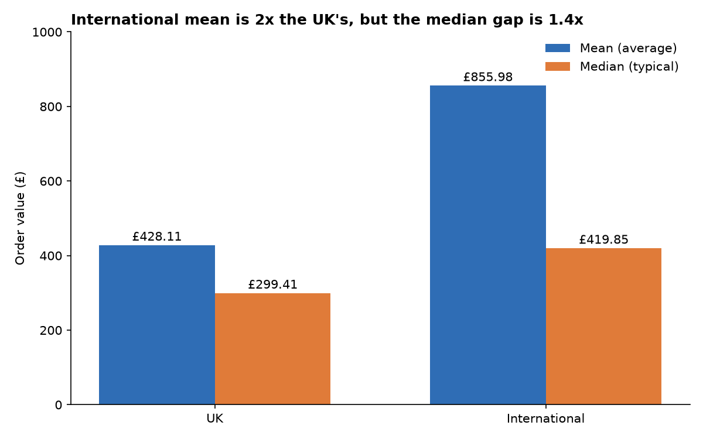
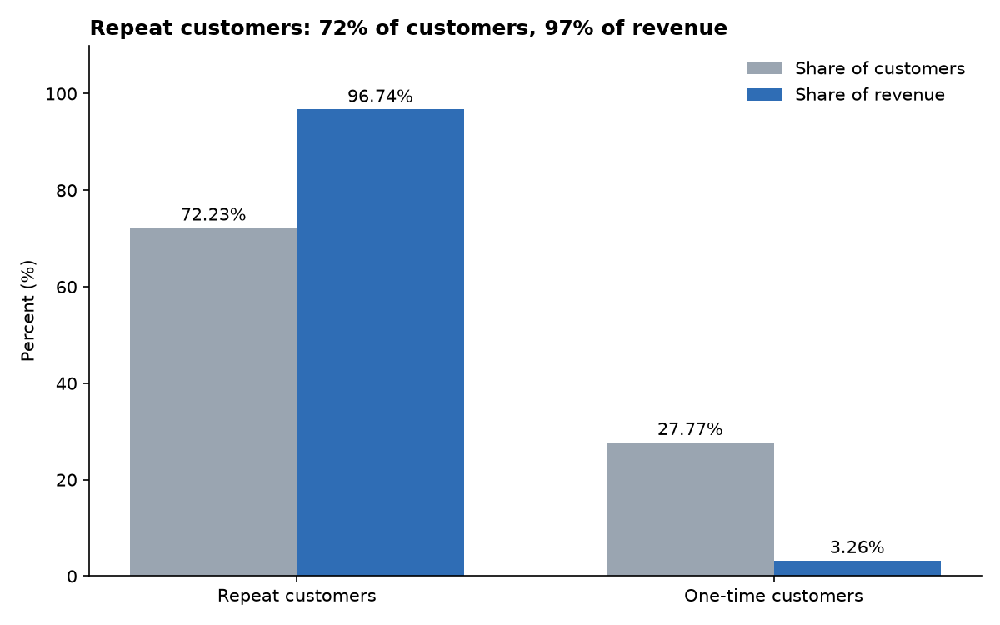
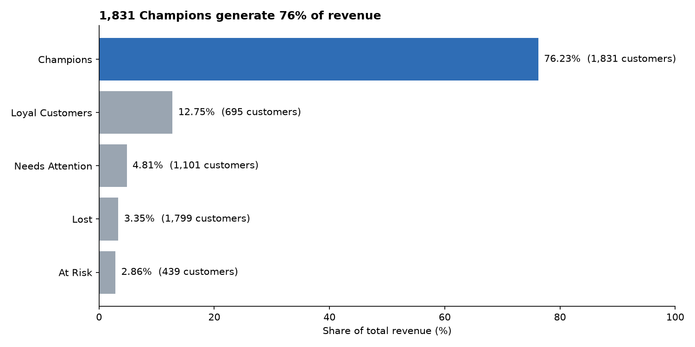
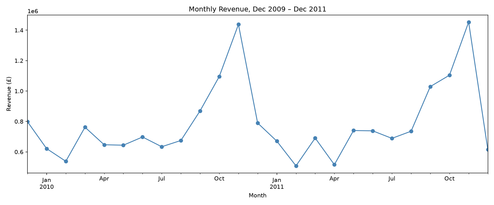
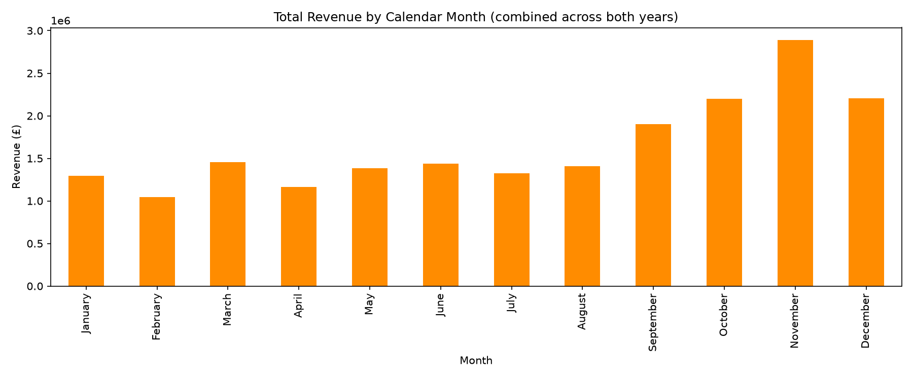

# UK E-commerce Sales & Customer Performance Analysis

An end-to-end analysis of two years of transactions from a UK online giftware retailer (about 1 million rows), using Python, PostgreSQL and SQL. It covers data cleaning, revenue trends, customer behaviour, RFM segmentation, geographic performance and cancellations, and ends with business recommendations and the limits of the analysis.

> The business scenario (a data analyst preparing a review for leadership's annual planning) is fictional. The data is real and public.

## Headline results

- **£19.7M** total revenue (Dec 2009 to Dec 2011) across 1,033,031 cleaned transactions.
- **Repeat customers are 72% of identified customers but generate 97% of their revenue.** 1,831 "Champions" generate 76%.
- **Revenue peaks in November** (Nov 2010 was 65% above Sep 2010), then drops in December.
- **International orders are worth about 2× UK orders on average, but only about 1.4× on the median**, and 5 customers generate 47% of international revenue.

## Business questions

1. What is total revenue, and how does it trend month-by-month across the two years?
2. Is there a seasonal pattern (e.g. a Q4/Christmas spike), and how large is it?
3. Which products generate the most revenue — and is that the same list as the most units sold?
4. What share of total revenue comes from the top 20% of customers (revenue concentration)?
5. What is the average order value, and how does it vary over time?
6. What proportion of customers are repeat buyers vs. one-time buyers, and how much revenue does each group generate?
7. How do customers segment under RFM (Recency, Frequency, Monetary), and what does each segment look like?
8. What is the cancellation rate, and does it concentrate in particular products, countries, or months?
9. Which countries outside the UK contribute meaningfully to revenue, and how does their average order value compare to the UK's?
10. Which products are disproportionately cancelled — a possible signal of quality or listing issues?
11. How concentrated is the customer base (does the business depend heavily on a small number of large wholesale-style buyers)?
12. Based on everything above, what recommendations would you give leadership?

## Dataset

**Online Retail II**, UCI Machine Learning Repository: real transactions from a UK-based online retailer, 1 Dec 2009 to 9 Dec 2011, about 1.07 million rows and about 40 countries.
Source: https://archive.ics.uci.edu/dataset/502/online+retail+ii (a Kaggle mirror is easier to download: https://www.kaggle.com/datasets/mashlyn/online-retail-ii-uci)

The raw file is not in this repository (GitHub's file size limit). Download it and place it in `data/raw/` as `online_retail_II.xlsx`.

## Key findings
### 1. International orders are worth more, but depend on a few customers

Among identified customers, international markets account for 8.9% of orders but 16.3% of revenue, because the average international order is about twice the UK's (£855.98 vs £428.11). The typical order is only about 1.4× higher (median £419.85 vs £299.41), and 5 of 526 international customers generate 47% of international revenue.

 

### 2. Repeat customers generate 97% of identified-customer revenue

Repeat customers (72.23% of identified customers) generate 96.74% of identified-customer revenue (£16,528,749.89), while one-time buyers generate just 3.26%. Within that, 1,831 "Champions" (customers who bought recently, often and with high spend) generate 76.23% of the revenue, so losing even a few of them would hurt.





### 3. Revenue peaks every November

Monthly revenue builds through autumn and peaks in November in both years. In 2010 it rose from £869,727.16 in September to £1,095,413.63 in October and £1,437,823.55 in November, then fell to £789,858.83 in December. The pattern is consistent with business customers stocking up before Christmas, though the data can't confirm the reason. (December 2011 contains only 9 days, so its drop is overstated.)




### 4. Cancellations are low and steady

Cancelled transactions are 1.85% of all transactions (19,104 of 1,033,031), and the monthly rate stays between 1.3% and 2.8% with no seasonal spike. November 2011, the peak revenue month, had one of the lowest rates (1.29%), which suggests fulfilment held up during the busiest period. A few products stand out by count: Regency Cakestand 3 Tier was cancelled 341 times and White Hanging Heart T-Light Holder 134 times, though both are also top sellers, so their cancellation *rates* still need checking.

## Recommendations

- **International:** Build dedicated account management for the top international customers and test whether growth in that segment holds, because 5 of 526 international customers generate 47% of international revenue.
- **Repeat customers:** Test early access or priority service for the 1,831 Champions, and run a win-back offer for the 439 At Risk customers before they lapse, because Champions generate 76% of identified-customer revenue.
- **Seasonality:** Plan stock and fulfilment capacity ahead of September–November, and contact customers who bought in previous autumns with early-booking offers, because revenue rose 65% from September to November 2010 (£869,727 to £1,437,824).
- **Cancellations:** Calculate cancelled units ÷ units sold for the top-selling products, then investigate those with the highest rates, because the overall rate is stable at 1.85% and the Regency Cakestand (341) and White Hanging Heart T-Light Holder (134) figures are counts, not rates.
## Limitations

**Coverage**
- One UK-based online retailer, Dec 2009 to Dec 2011, so results may not generalise.
- December 2011 contains only 9 days, so that month is understated; seasonal conclusions rest on only two Novembers.

**Data quality**
- About 22.8% of rows (243,007) have no Customer ID. These guest orders are 13.3% of revenue (£2,614,956.24) and are excluded from customer-level analysis (repeat rate, RFM, concentration, country comparison).
- 486 product codes (1.84% of revenue, £362,819.20) carry the description "Unknown" and are excluded from product-level results. Part of this is probably an artefact of how the `products` table keeps the first description per stock code.
- 34,335 exact duplicate rows (~3.2%) were removed in cleaning on the assumption they are accidental double entries; the data cannot confirm this. If every one were a genuine repeat purchase, revenue would be understated by at most about £496,000 (about 2.5% of £19.7M), which would be unlikely to change the direction of any finding.
- Cancelled orders (1.85% of transactions) were removed from revenue and analysed separately. The data gives no cancellation reasons.

**Analysis choices**
- All figures are revenue. There is no cost, margin or shipping data, so profitability can't be assessed.
- RFM segment boundaries come from quartile scoring, and the labels are a judgement call.
- "One-time buyers" may include recent customers whose second order falls after the data ends.
- Order-value averages are skewed by a few very large orders, so the median is reported alongside the mean.

**What the data cannot show**
- The data is observational. The findings show patterns, not causes, and the recommendations are hypotheses to test.


## Methods and tools

- **Python (pandas, NumPy, Matplotlib):** cleaning, flags for cancellations / non-product entries / stock adjustments, charts
- **PostgreSQL + SQL:** star schema (customers, products, transactions); joins, CASE, CTEs, subqueries, window functions (`NTILE`, `LAG`, `RANK`, running totals), RFM segmentation
- **Jupyter Notebook, Git/GitHub**

## Project structure

```
Ecommerce-sales-analysis/
├── data/
│   ├── raw/          # online_retail_II.xlsx (not in the repo)
│   └── processed/    # cleaned CSVs generated by notebook 01 (not in the repo)
├── notebooks/
│   ├── 01_data_quality_and_cleaning.ipynb
│   ├── 02_revenue_trends_and_product_performance.ipynb
│   ├── 03_postgresql_setup_and_sql_analysis.ipynb
│   ├── 04_business_insights_and_recommendations.ipynb
│   └── 05_final_charts.ipynb
├── sql/
│   ├── 01_joins_and_case.sql
│   ├── 02_cte_and_window_function.sql
│   ├── 03_customer_behaviour.sql
│   ├── 04_rfm_segmentation.sql
│   ├── 05_geographic_performance.sql
│   ├── 06_cancellation_analysis.sql
│   └── 07_advanced_sql.sql
├── visuals/
├── README.md
├── requirements.txt
└── .gitignore
```

## How to run it

1. Clone the repo and create an environment:
   ```
   git clone https://github.com/Abdulmuizz1234/Ecommerce-sales-analysis.git
   cd Ecommerce-sales-analysis
   python -m venv .venv
   .venv\Scripts\activate
   pip install -r requirements.txt
   ```
   On Mac or Linux, use `source .venv/bin/activate` instead of the activate line above.
2. Create the folders `data/raw` and `data/processed` in the project root. Download the dataset (link above) and save it as `data/raw/online_retail_II.xlsx`.
3. Run `notebooks/01_data_quality_and_cleaning.ipynb`. It cleans the data and writes the processed CSVs to `data/processed/`.
4. Install PostgreSQL, create a database called `ecommerce`, set your password in the connection string in notebook 03, and run it to load the `customers`, `products` and `transactions` tables.
5. Run the SQL files in `sql/` in order (01 to 07) in pgAdmin's Query Tool or `psql`.
6. Run notebooks 02, 04 and 05 for the charts and the written insights.

